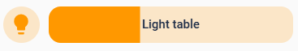

Smart lights, many have a lot of them and adding them all to a dashboard means they take up a lot of screen real estate. In this step-by-step guide we will create a minimalist light card and **move ALL of its styling into themes**.

For this guide we will use the mushroom light card (which is smaller to start with) and use it to control a dimmable light. The screenshot shows a standard light card, a standard mushroom light card, a horizontal layout mushroom light card, a horizontal layout mushroom light card without any info / name and the minimalist light card we want to create (I duplicated the minimalist card to show we can also move them closer together and save more space):


We can apply this style at card level, which looks like below. Note the templates in the uix section use **config.entity**, this is used to mimic the standard color changing behaviour depending on whether the light is on or off (and retrieves the friendly name of the entity) and means the entity needs to be changed only at the entity: key.

The various styling blocks are needed for (in order):
- changing the background and 3D effect of the circle around the icon
- setting the colors of the brightness slider, its radius and 3D effect
- removing the card border, card background and shifting the icon to where the border used to be
- removing the default grey background as we are setting a 3D outline effect on the slider 
- changing the icon and its color
- position the slider and allow it expand to where the border used to be
- create a new CSS element with the name of the entity centered inside the slider

```
type: custom:mushroom-light-card
entity: light.light_living_room
name:
  type: entity
show_brightness_control: true
primary_info: none
secondary_info: none
layout: horizontal
icon_color: transparent
uix:
  style:
    mushroom-shape-icon$: |
      .shape {
        
          box-shadow: inset 0px -1px 2px lightgrey, 0 3px 5px rgb(from var(--primary-text-color) r g b / 0.1) !important;
          background: None !important;
        
          box-shadow: inset 0px -2px 7px rgb(from cornflowerblue r g b / 0.9), 0 3px 5px rgb(from var(--primary-text-color) r g b / 0.25) !important;
          background: rgb(from cornflowerblue r g b / 0.6) !important;
        
      }
    mushroom-light-brightness-control$:
      mushroom-slider$: |
        .slider {
          --main-color: rgb(from cornflowerblue r g b / 0.4) !important;
          --bg-color: rgb(from cornflowerblue r g b / 0.2) !important;
          border-radius: 21px !important;
          
            box-shadow: inset 0px -1px 2px lightgrey, 0 3px 5px rgb(from var(--primary-text-color) r g b / 0.1) !important;
          
            box-shadow: inset 0px -2px 7px rgb(from cornflowerblue r g b / 0.9), 0 3px 5px rgb(from var(--primary-text-color) r g b / 0.25) !important;
          
        }
    .: |
      ha-card {
        border-width: 0px;
        --ha-card-background-clip: padding-box;
        --ha-card-background: --primary-background-color;
        margin-left: -8px;
      }
      mushroom-light-brightness-control {
        --rgb-disabled: 255, 255, 255 !important;
      } 
      ha-state-icon {
        
          --card-mod-icon: local:mdi-light--lightbulb;
          color: silver;
        
          --card-mod-icon: local:mdi-light--lightbulb-on;
          color: white;
        
      }
      mushroom-light-brightness-control {
        position: absolute;
        width: calc(100% - 52px);
        top: 10px;
        right: 0px;
      }
      mushroom-light-brightness-control:after {
        content: "{{ state_attr(config.entity, 'friendly_name') }}";
        position: relative;
        display: flex;
        justify-content: center;
        color: var(--primary-text-color);
        font-weight: 500;
        top: -28px;
        width: 100%;
        height: 16px;
        font-size: 12px;
        pointer-events: none;
      }
```
This will apply to all cards, not only our minimalist light card, we will see later how styling can be applied to specific card classes only.

Next, we choose the horizontal lay-out which brings the slider next to the icon and remove both primary and secondary info (the name is no longer readable anyway unless we give the card a lot of horizontal space and the state is obvious from the color change). To bring the name of the light back we add a CSS element to the slider (we also need to reposition it and remove the right margin)



The card YAML now looks like this:
```
type: custom:mushroom-light-card
entity: light.light_table
name:
  type: entity
show_brightness_control: true
primary_info: none
secondary_info: none
layout: horizontal
uix:
  style: |
    mushroom-light-brightness-control {
      position: absolute;
      width: calc(100% - 55px);
      top: 10px;
      right: 0px;
    }

    mushroom-light-brightness-control:after {
      content: "Light table";
      position: relative;
      display: flex;
      justify-content: center;
      color: var(--primary-text-color);
      font-weight: 500;
      top: -28px;
      width: 100%;
      height: 16px;
      font-size: 12px;
      pointer-events: none;
    }
```
At this point we have the basic layout for a minimalist light card and we start theming. Mushroom offers multiple colour options but if we want a custom theme color we lose the changes when toggling the light so we will bring those back. In this example we will theme the  
