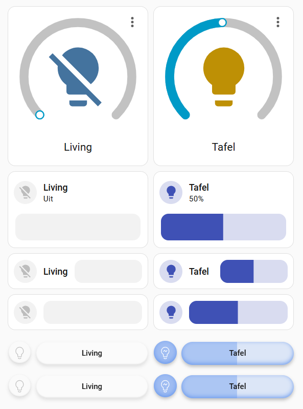

Smart lights, everybody has a lot of them and adding them all to a dashboard means they take up a lot of screen real estate. In this step-by-step guide we will create a minimalist light card and **move ALL of its styling into themes**. See [tile-card-inline-feature-switch](https://uix-guides.lf.technology/forge/2026/04/11/tile-card-inline-feature-switch.html) to learn how to add additional controls (such as color control) to cards, and see [getting-shadowy-with-themes-host-element-selector](https://uix-guides.lf.technology/elements/2026/03/29/getting-shadowy-with-themes-host-element-selector.html) for another example on how to use the host element selector.

For this guide we will use the mushroom light card (which is smaller to start with) and use it to control a dimmable light. The screenshot shows a standard light card, a standard mushroom light card, a horizontal layout mushroom light card, a horizontal layout mushroom light card without any info / name and the minimalist light card we want to create (the minimalist card is duplicated to show we can also move them closer together and save more space):



We can achieve this using uix styling at card level, which looks like below. The various styling blocks are needed for (in order):
- changing the background and 3D effect of the circle around the icon
- setting the colors of the brightness slider, its radius and 3D effect
- removing the card border, card background and shifting the icon to where the left border used to be
- removing the default grey background which is no longer needed as we are setting a 3D outline effect on the slider 
- changing the icon and its color
- position the slider and allow it to expand to where the right border used to be
- create a new CSS element with the name of the entity centred inside the slider

Note the templates in the uix section use **config.entity**, this is used to mimic the standard color changing behaviour depending on whether the light is on or off (and to retrieve the friendly name of the entity). Using config.entity means the entity needs to be changed only at the entity: key and code can easily be copied to another card. Note also we can refer to CSS variables such as **--primary-text-color** and we can get a different shade of a color with the **rgb function**.

```
type: custom:mushroom-light-card
entity: light.light_living_room
name:
  type: entity
show_brightness_control: true
primary_info: none
secondary_info: none
layout: horizontal
icon_color: transparent
uix:
  style:
    mushroom-shape-icon$: |
      .shape {
        
          box-shadow: inset 0px -1px 2px lightgrey, 0 3px 5px rgb(from var(--primary-text-color) r g b / 0.1) !important;
          background: None !important;
        
          box-shadow: inset 0px -2px 7px rgb(from cornflowerblue r g b / 0.9), 0 3px 5px rgb(from var(--primary-text-color) r g b / 0.25) !important;
          background: rgb(from cornflowerblue r g b / 0.6) !important;
        
      }
    mushroom-light-brightness-control$:
      mushroom-slider$: |
        .slider {
          --main-color: rgb(from cornflowerblue r g b / 0.4) !important;
          --bg-color: rgb(from cornflowerblue r g b / 0.2) !important;
          border-radius: 21px !important;
          
            box-shadow: inset 0px -1px 2px lightgrey, 0 3px 5px rgb(from var(--primary-text-color) r g b / 0.1) !important;
          
            box-shadow: inset 0px -2px 7px rgb(from cornflowerblue r g b / 0.9), 0 3px 5px rgb(from var(--primary-text-color) r g b / 0.25) !important;
          
        }
    .: |
      ha-card {
        border-width: 0px;
        --ha-card-background-clip: padding-box;
        --ha-card-background: --primary-background-color;
        margin-left: -8px;
      }
      mushroom-light-brightness-control {
        --rgb-disabled: 255, 255, 255 !important;
      } 
      ha-state-icon {
        
          --card-mod-icon: local:mdi-light--lightbulb;
          color: silver;
        
          --card-mod-icon: local:mdi-light--lightbulb-on;
          color: white;
        
      }
      mushroom-light-brightness-control {
        position: absolute;
        width: calc(100% - 52px);
        top: 10px;
        right: 0px;
      }
      mushroom-light-brightness-control:after {
        content: "{{ state_attr(config.entity, 'friendly_name') }}";
        position: relative;
        display: flex;
        justify-content: center;
        color: var(--primary-text-color);
        font-weight: 500;
        top: -28px;
        width: 100%;
        height: 16px;
        font-size: 12px;
        pointer-events: none;
      }
```

We can achieve the same with a theme, as per below:
- create a variable MainThemeColor for the base color (this will be used extensively in other styling elements)
- create variables for shades of the  MainThemeColor, used to style different elements of our light card
- create variables for the icons and their color, change to MDI icons if you only have those on your system
- All elements under uix-card-yaml: will apply to the CSS class minimalist-light-card-with-slider, this ensures the styling is applied only to light cards with this CSS class (for example in case you also have normal light cards in your dashboard)
- There are three main blocks below, each block starts with the **host element path selector**, followed by the name of our **CSS class** and optional elements to pierce the shadow DOM and target the host / card, the shape-icon or the slider.
- The main block:
  - creates a variable lightisOn at host level using **config.entity** to dynamically style elements. This is used for the icon but also to create two more variables for the background and box-shadow which can be accessed in lower DOM levels, in this case to dynamically style the shape icon and the slider.
  - at ha-card level, removes the border and align left to where the border used to be
  - at ha-state-icon, uses templates based on lightisOn to set the icon and its color to variables defined at the beginning of the theme
  - positions the brightness control and remove the default grey background when the light is off
  - adds a new CSS element centred in the slider
- The shape icon block:
  - uses the background and box-shadow variables created at host and applies those to the shape icon
- The slider block:
  - sets the three slider colors
  - uses the box-shadow variable created at host and applies that to the slider

```
  themes: 
    MyAwesomeTheme:
      uix-theme: MyAwesomeTheme

      MainThemeColor: "#6495ED"   #cornflowerblue, all colors in the block below depend on this

      primary-text-color: rgb(from var(--MainThemeColor) calc(r * 0.3) calc(g * 0.3) calc(b * 0.3) )
      mythemebackground: rgb(from var(--MainThemeColor) r g b / 0.6)
      mysliderbackground: rgb(from var(--MainThemeColor) r g b / 0.2)
      myfillsliderbackground: rgb(from var(--MainThemeColor) r g b / 0.4)
      mygreyboxshadow: inset 0px -1px 2px lightgrey, 0 3px 5px rgb(from var(--primary-text-color) r g b / 0.1)
      mythemeboxshadow: inset 0px -2px 7px rgb(from var(--MainThemeColor) r g b / 0.9), 0 3px 5px rgb(from var(--primary-text-color) r g b / 0.25)

      OniconColor: "white"
      OfficonColor: "silver"
      lightOffIcon: "local:mdi-light--lightbulb"
      lightOnIcon: "local:mdi-light--lightbulb-on"

      uix-card-yaml: |
        "&.minimalist-light-card-with-slider": |
          :host {
            
            --mythemebackground-if-isOn:  var(--mythemebackground)  None ;
            --mythemeboxshadow-if-isOn:  var(--mythemeboxshadow)  var(--mygreyboxshadow) ;
            
            ha-card {
                --ha-card-border-width: 0px;
                margin-left: -8px;
            }
            
            ha-state-icon {
              --card-mod-icon:  var(--lightOnIcon)  var(--lightOffIcon) ;
              color:  var(--OniconColor)  var(--OfficonColor) ;
            }

            mushroom-light-brightness-control {
              position: absolute;
              width: calc(100% - 52px);
              top: 10px;
              right: 0px;
              --rgb-disabled: 255, 255, 255 !important;
            }
            
            mushroom-light-brightness-control::after {
              content: "{{ state_attr(config.entity, 'friendly_name') }}";
              position: relative;
              display: flex;
              justify-content: center;
              color: var(--primary-text-color);
              font-weight: 500;
              top: -28px;
              width: 100%;
              height: 16px;
              font-size: 12px;
              pointer-events: none;
            }
          }

        "&.minimalist-light-card-with-slider mushroom-shape-icon$": |
          .shape {
            background: var(--mythemebackground-if-isOn) !important;
            box-shadow: var(--mythemeboxshadow-if-isOn) !important;
          }

        "&.minimalist-light-card-with-slider mushroom-light-brightness-control$ mushroom-slider$": |
          .slider {
            border-radius: 21px !important;
            --main-color: var(--myfillsliderbackground) !important;
            --bg-color: var(--mysliderbackground) !important;
            box-shadow: var(--mythemeboxshadow-if-isOn) !important;
          }

```

Now we can remove ALL of the styling at card level and only need to set the CSS class. The example below shows two minimalist light cards and how to modify the gap and reduce the row height from the standard 56px.

```
type: grid
columns: 1
square: false
uix:
  style: |
    #root { 
      gap: 0px !important;
      grid-auto-rows: 52px !important;
    }
cards:
  - type: custom:mushroom-light-card
    entity: light.light_living_room
    name:
      type: entity
    show_brightness_control: true
    primary_info: none
    secondary_info: none
    layout: horizontal
    icon_color: transparent
    uix:
      class: minimalist-light-card-with-slider
  - type: custom:mushroom-light-card
    entity: light.light_living_room
    name:
      type: entity
    show_brightness_control: true
    primary_info: none
    secondary_info: none
    layout: horizontal
    icon_color: transparent
    grid_options:
      columns: 6
    uix:
      class: minimalist-light-card-with-slider
```
