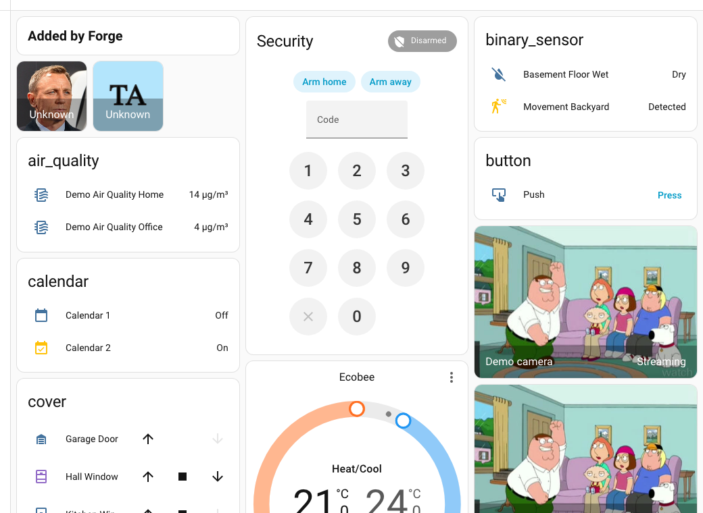
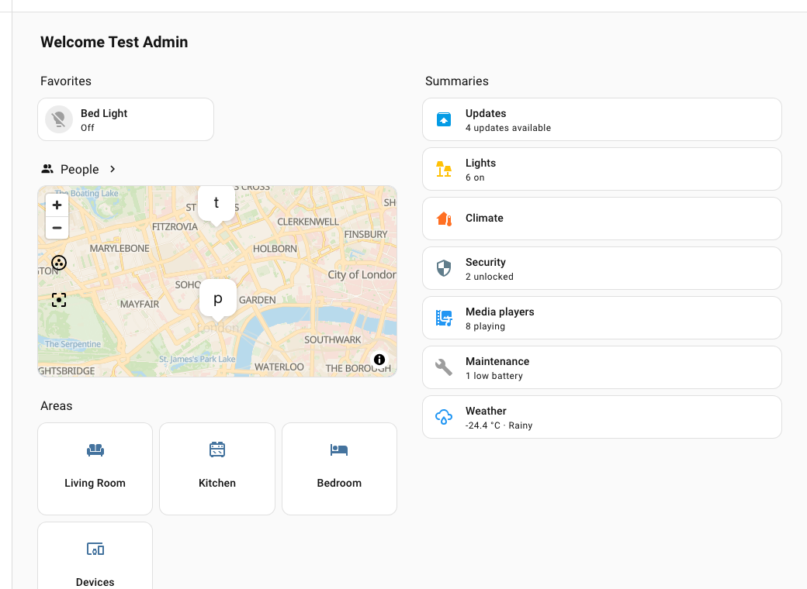
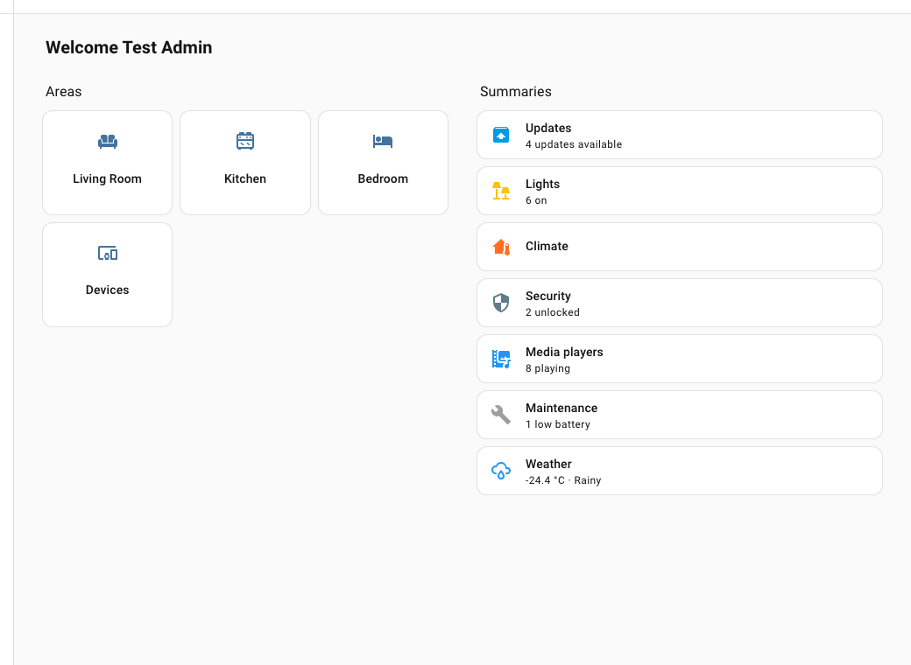
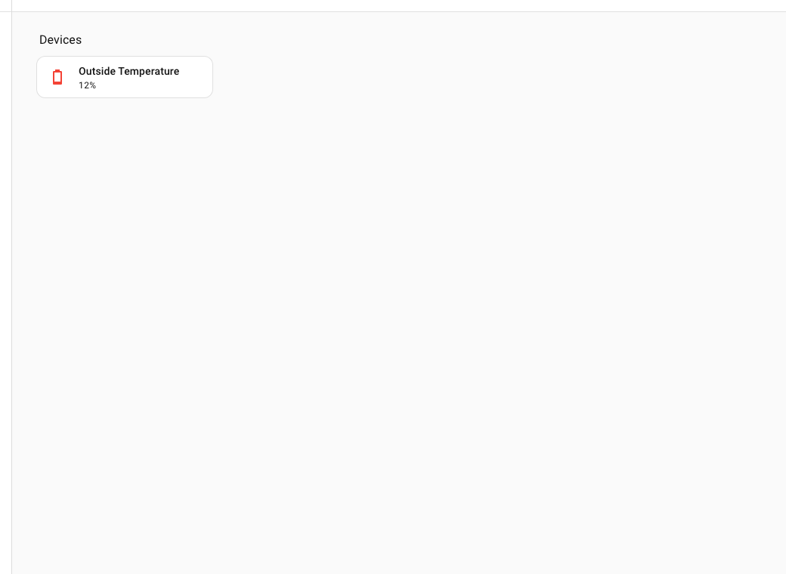

# Configuration Spark

Use the Configuration Spark to add a card to a generated dashboard, remove an unwanted section, or change an option before Home Assistant renders it. Each edit is a **patch**. Add a `type: config` Spark under `forge.sparks` and list its patches in the order you want them applied.

In this dashboard example, Home Assistant's `original-states` View strategy builds the usual cards. The `prepend` patch puts a full-width Markdown card at the top of that View's `cards` list.



```yaml
title: Forge strategy configuration
views:
  - path: overview
    strategy:
      type: custom:uix-forge
      forge:
        mold: strategy
        sparks:
          - type: config
            patches:
              - op: prepend
                path: /cards
                value:
                  type: markdown
                  content: "## Added by Forge"
                  grid_options:
                    columns: full
      element:
        type: original-states
```

## Paths and operations

For a patch with `path`, use a [JSON Pointer](https://www.rfc-editor.org/rfc/rfc6901) to say where the edit goes. Use `/cards` for the whole cards list, `/cards/0` for its first card, or `""` for the whole config. If a key contains a literal `/` or `~`, write it as `~1` or `~0`.

??? info "Why JSON Pointer rather than JSONPath?"
    A JSON Pointer gives an exact address. For example, `/cards/0` means “the first card.” JSONPath can search for many results, which is handy for extracting data from a REST response. When a generated card or section may move, use Forge's `select` to find it by what it contains, then use a pointer to reach a field inside it.

| Operation | Use it to |
| --- | --- |
| `merge` | edit a mapping without replacing its other keys |
| `replace` | replace a value or the complete config |
| `remove` | remove an existing mapping key or array item |
| `remove_matching` | remove items matching `where` from one list or from every list named by `all` |
| `wrap_strategy` | augment a child strategy emitted by another strategy without copying its source config |
| `wrap_card` | augment a generated card without copying its source config |
| `append` / `prepend` | add an item at either end of an array |
| `insert_before` / `insert_after` | insert beside a selected or indexed array item |

`merge` updates matching keys inside mappings and keeps the other keys. A list, single value, or `null` replaces the previous value at that key.

### Patch fields

| Field | Used by | Meaning |
| --- | --- | --- |
| `op` | every patch | The operation from the table above. |
| `path` | every operation | Point to the target by its exact location. |
| `select` | every operation | Find one item by its contents. See the fields below. |
| `all` | `remove_matching`, `wrap_card` | Visit every list with this exact key, such as `cards` or `entities`. For `wrap_card`, use `all: cards`. |
| `value` | `merge`, `replace`, `wrap_strategy`, `wrap_card`, `append`, `prepend`, `insert_before`, `insert_after` | The data to write. |
| `where` | `remove_matching`, `wrap_card` with `all` | Match each item in the target list. |
| `required` | `wrap_card` with `all` | Set to `false` to allow zero matching cards. |

Each patch takes exactly one target. Use `path` for an exact location, `select` to find one item, or `all` to visit lists with a given key.

### `select` and `where` matchers

Use `select` when you know what an item looks like but its position can change. For example, find the section that contains the Favorites heading, then edit its `cards` list.

| Field under `select` | What to write |
| --- | --- |
| `in` | A JSON Pointer to the list to search, such as `/sections`. |
| `match` | The fields that identify exactly one item in that list. |
| `path` | An optional JSON Pointer within that item, such as `/cards`. Omit it to target the item itself or to insert beside it. |
| `required` | Defaults to `true`. Set to `false` to skip the patch when no item matches. |

`select.match` identifies one target. `where` checks each item in a target list. Both accept the same matching rules, including the Forge operators prefixed with `$`.

| Matcher form | Meaning |
| --- | --- |
| `type: tile` | A direct key/value match. Mapping matches are partial, so unspecified keys do not matter. |
| `$contains: [...]` | The list contains a distinct item for each rule. For example, find a section by one of its cards. |
| `$in_entities: no_favs` | The value is an entity ID selected by the Entities Spark named `no_favs` in the same Forge. |

This patch removes cards whose own `entity` matches the query, regardless of card type. Add `type: tile` under `where` to limit it to Tiles.

```yaml
- op: remove_matching
  all: cards
  where:
    entity:
      $in_entities: no_favs
```

`all: cards` visits lists named `cards` throughout the config, including those inside stacks and sections. Use `all: entities` to visit lists named `entities`. In both cases the patch checks the immediate items in each list. Service targets, conditions, and other entity references within those items are outside the match.

A template in `value` can return a JSON object or list with `| tojson`. Forge uses the resulting mapping or list as the patch value.

## Strategies

Put the Spark in the [Forge strategy](../forge.md#strategies) that generates the part you want to change. A Dashboard strategy can produce a `/views` list. A View strategy can produce `/cards` or `/sections`. The paths you use in a patch come from that strategy's output. Use the [strategy inspector](#inspect-generated-strategies) to see which lists and fields it actually produces.

### Wrap a generated child strategy

Home Assistant's `home` Dashboard strategy creates a list of Views, including an Overview whose own `home-overview` strategy generates its cards later. To edit those cards, use `wrap_strategy` on the View's `strategy` entry and put the card patches inside that wrapper. The other Views stay as Home generated them.

Point `path` or `select.path` at the nested `strategy` key. In `value`, provide the settings you want to add, including `forge.mold: strategy` or a Foundry that supplies it. Forge adds `type: custom:uix-forge` and saves the original strategy settings as `element_base`. You can edit an existing Forge strategy directly.

### Add a People map after Home Dashboard Summaries

Add a People section with a map beneath Summaries in the main Overview layout while keeping Home's area subviews. Replace the two example trackers with your own people or device trackers. Use the full YAML when setting up the dashboard and check [which part to paste when editing it later](#create-or-edit-the-dashboard).

```yaml
title: My Home
views: []
strategy:
  type: custom:uix-forge
  forge:
    mold: strategy
    sparks:
      - type: config
        patches:
          - op: wrap_strategy
            select:
              in: /views
              match:
                strategy:
                  type: home-overview
              path: /strategy
            value:
              forge:
                mold: strategy
                sparks:
                  - type: config
                    patches:
                      - op: insert_after
                        select:
                          in: /sections
                          match:
                            type: grid
                            cards:
                              $contains:
                                - type: home-summary
                        value:
                          type: grid
                          column_span: 4
                          cards:
                            - type: heading
                              heading: People
                              icon: mdi:account-multiple
                              tap_action:
                                action: navigate
                                navigation_path: /map
                            - type: map
                              entities:
                                - device_tracker.phone
                                - device_tracker.tablet
                              grid_options:
                                columns: full
  element:
    type: home
    favorite_entities:
      - light.bed_light
```



The outer patch finds the Overview View in `/views` and wraps its `/strategy`, keeping Home's settings such as `favorite_entities`. The inner patch finds the main section that contains a Home Summary card and inserts People after it. On a wide screen, Home can show Summaries in the sidebar while People remains in the main layout. Select the People heading to open Home Assistant's Map page.

### Wrap generated cards

`wrap_card` turns a generated card into a Card Forge. Put your additions in `value` and let Forge save the original card settings as `element_base`. Use `path` or `select` to wrap one card, or `all: cards` with `where` to wrap every matching card. With `all: cards`, add `required: false` beside `all` if finding no cards is acceptable.

#### Filter Maintenance on Home and on the page it opens

Use the same exclusion list for the Maintenance summary and the page it opens. This example wraps the summary in both the main layout and the sidebar, then sends both cards to a filtered Maintenance subview within your dashboard.

1. In Home Assistant, create the label `excluded_from_maintenance` and assign it to the entities you want to leave out. Keep the Maintenance summary enabled in Home so Forge has a card to wrap.
2. In UIX, create a [Foundry](../foundries.md) called `maintenance-exclusions` with the YAML below. It holds the filter for both the summary cards and the Maintenance subview.
3. Use the dashboard YAML below. Change `/filtered-home-maintenance` in `navigation_path` to your dashboard's URL path and keep the ending `/maintenance`. See [creating and editing the dashboard](#create-or-edit-the-dashboard).

```yaml
# Foundry: maintenance-exclusions
forge:
  sparks:
    - type: entities
      id: excluded_from_maintenance
      filter:
        include:
          - label: excluded_from_maintenance
```

```yaml
title: Filtered Home Maintenance
views: []
strategy:
  type: custom:uix-forge
  forge:
    mold: strategy
    sparks:
      - type: config
        patches:
          - op: wrap_strategy
            select:
              in: /views
              match:
                strategy:
                  type: home-overview
              path: /strategy
            value:
              forge:
                mold: strategy
                sparks:
                  - type: config
                    patches:
                      - op: wrap_card
                        all: cards
                        where:
                          type: home-summary
                          summary: maintenance
                        value:
                          foundry: maintenance-exclusions
                          forge:
                            mold: card
                            sparks:
                              - type: home-summary
                                exclude:
                                  - $in_entities: excluded_from_maintenance
                          element:
                            tap_action:
                              action: navigate
                              # Replace this dashboard URL path if different.
                              navigation_path: /filtered-home-maintenance/maintenance
          - op: append
            path: /views
            value:
              title: Maintenance
              path: maintenance
              subview: true
              strategy:
                type: custom:uix-forge
                foundry: maintenance-exclusions
                forge:
                  mold: strategy
                  sparks:
                    - type: config
                      patches:
                        - op: remove_matching
                          all: cards
                          where:
                            entity:
                              $in_entities: excluded_from_maintenance
                element:
                  type: maintenance
  element:
    type: home
```

On Overview, the [Home Summary Spark](home-summary.md) excludes the labelled entities from the native Maintenance count. The `tap_action` opens the appended subview.



The subview runs Home Assistant's Maintenance strategy and uses the same Foundry filter to remove generated cards whose `entity` matches. In the screenshot, the labelled Carbon dioxide item is absent. The `subview: true` setting keeps Maintenance out of the tab bar.



The built-in Maintenance page still uses Home Assistant's original list. You can use this same pattern for Lights or Security by wrapping the matching summary and creating a subview for its View strategy.

### Remove labelled Favorites suggestions

Label entities `no_favs` in Home Assistant to keep their cards out of the generated Favorites section. This example also removes the entire Other areas section. It wraps the Overview View and uses an [Entities Spark query](entities.md#reuse-a-query-result) to collect the IDs. Two patches then find the generated sections by heading.

```yaml
title: My Home
views: []
strategy:
  type: custom:uix-forge
  forge:
    mold: strategy
    sparks:
      - type: config
        patches:
          - op: wrap_strategy
            select:
              in: /views
              match:
                strategy:
                  type: home-overview
              path: /strategy
            value:
              forge:
                mold: strategy
                sparks:
                  - type: entities
                    id: no_favs
                    filter:
                      include:
                        - label: no_favs
                  - type: config
                    patches:
                      - op: remove_matching
                        select:
                          in: /sections
                          required: false
                          match:
                            cards:
                              $contains:
                                - type: heading
                                  heading: Favorites
                          path: /cards
                        where:
                          entity:
                            $in_entities: no_favs
                      - op: remove
                        select:
                          in: /sections
                          required: false
                          match:
                            type: grid
                            cards:
                              $contains:
                                - type: heading
                                  heading: Other areas
  element:
    type: home
```

The Favorites patch targets the matched section's `/cards` list and removes any card with a matching `entity`, regardless of card type. The Other areas patch targets the section itself. Each patch can skip a missing section. If your dashboard uses a different language, inspect its generated headings and use the text you see there.

### Create or edit the dashboard

When the raw editor shows the whole dashboard, paste the full example starting with `title`, `views`, and `strategy`. After you save a strategy dashboard, Home Assistant may open an editor for just the strategy. If it starts with `type: custom:uix-forge`, copy the contents under `strategy:` and remove two spaces of indentation so `type` starts at the left margin. Pasting the full dashboard there nests a second `strategy:` and causes “No strategy type found.”

## Inspect generated strategies

Use the browser DevTools **Console** to inspect a strategy's output before choosing a patch target. For Home, open the native Home dashboard and run these commands in order. Each inspector saves its latest report on `window.uix_inspect` for the next command.

### Find the generated config

`uix_dashboard_inspect()` reads the open dashboard. Its report contains the saved configuration as `rawConfig`, the config Home Assistant is rendering as `generatedConfig`, and the top-level strategy settings as `strategy`. Copy `window.uix_inspect.dashboard.strategy` into Forge's `element` if you want to start with the same Home settings. See the [dashboard inspector reference](../../concepts/dom.md#uix_dashboard_inspect-current-dashboard-helper).

```js
uix_dashboard_inspect();
window.uix_inspect.dashboard.strategy;
```

`uix_strategy_inspect(scope, element)` runs the strategy and saves its output as `window.uix_inspect.strategy.config`. Pass the scope (`"dashboard"`, `"view"`, or `"section"`) and the same strategy settings you plan to use in Forge's `element`. To inspect Home Overview with the options it inherits from Home, generate the Dashboard first, then pass its generated `home-overview` strategy to the helper. See the [strategy inspector reference](../../concepts/dom.md#uix_strategy_inspectscope-element-strategy-config-helper).

```js
await uix_strategy_inspect("dashboard", window.uix_inspect.dashboard.strategy);
await uix_strategy_inspect(
  "view",
  window.uix_inspect.strategy.config.views.find(
    (view) => view.strategy?.type === "home-overview",
  ).strategy,
);
```

Use `paths(term)` to search the latest report by path or previewed value. Then use `get(path)` to read an exact value. In this case, inspect the sections before choosing a particular card list.

```js
window.uix_inspect.strategy.paths("home-summary");
window.uix_inspect.strategy.paths("Favorites");
window.uix_inspect.strategy.get("/sections");
```

### Test a patch

`window.uix_inspect.strategy.test(patches, entitySets?)` takes the patch list you would put under `patches:`. It runs the edits on a copy of the inspected output, logs the result or an error, and leaves your dashboard as it is. This example checks whether a patch can insert a card into the main Summaries section of the Overview you just inspected.

```js
window.uix_inspect.strategy.test([
  {
    op: "append",
    select: {
      in: "/sections",
      match: {
        cards: { $contains: [{ type: "home-summary", summary: "light" }] },
      },
      path: "/cards",
    },
    value: { type: "tile", entity: "light.kitchen" },
  },
]);
```

This example assumes the Lights summary is enabled. If you have hidden it, use the `summary` of a card you found with `paths("home-summary")`.

To test the [Favorites exclusion](#remove-labelled-favorites-suggestions), first collect the IDs using the [Entities inspector](entities.md#inspect-a-list). Then pass those IDs under the same name as the patch's `$in_entities` reference. Keep the Overview report loaded from the previous steps.

```js
await uix_entities_inspect({
  type: "custom:uix-forge",
  forge: {
    mold: "strategy",
    sparks: [{
      type: "entities",
      id: "no_favs",
      filter: { include: [{ label: "no_favs" }] },
    }],
  },
  element: { type: "home-overview" },
}, "no_favs");
```

```js
window.uix_inspect.strategy.test(
  [{
    op: "remove_matching",
    select: {
      in: "/sections",
      required: false,
      match: { cards: { $contains: [{ type: "heading", heading: "Favorites" }] } },
      path: "/cards",
    },
    where: { entity: { $in_entities: "no_favs" } },
  }],
  { no_favs: window.uix_inspect.entities.ids },
);
```

### Try paths in a JSON Pointer tester

If you prefer a visual tool, copy the generated config from DevTools. Open [JsonKit's JSON Pointer tester](https://jsonkit.com/jsonpath-tester), select **JSON Pointer**, and paste the JSON into the Input panel. Try `/sections/0/cards` to see the cards in the first section. Remove personal details from the copied config before pasting it into an external site.

```js
copy(JSON.stringify(window.uix_inspect.strategy.config, null, 2));
```

Use the tester for exact pointers, then use [`test()`](#test-a-patch) to try Forge's `select` rules and patches.

## Safe failure and optional output

If a path is invalid, a patch targets the wrong kind of value, or a selection fails, Forge shows an error instead of rendering a partially patched result.

Use `select.required: false` when the list exists but the item is optional. For example, this removes an optional status badge if it appears. Multiple matches still raise an error.

```yaml
- op: remove
  select:
    in: /badges
    match:
      type: entity
      entity: sensor.optional_status
    required: false
```
