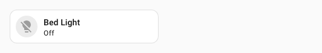

# Entities Spark

!!! info
    Entities Spark available in 9.2.0-beta.3

Use the Entities Spark to fill an Entities card with filtered entities, build a Grid of Tiles for a room, or collect entity IDs to use in another Spark. It uses the entity matching rules from the [Lint Free Technology fork of auto-entities](https://github.com/Lint-Free-Technology/lovelace-auto-entities).

## Create cards without an auto-entities wrapper

This Grid shows a Tile for each entity in the Bedroom area, skipping any whose state is `unavailable`. Replace `bedroom` with one of your own areas. The Spark's `path: /cards` fills the Grid's `cards` list, and its `element` supplies the Tile config. Forge sets each Tile's `entity` for you.

```yaml
type: custom:uix-forge
forge:
  mold: card
  sparks:
    - type: entities
      path: /cards
      element:
        type: tile
      filter:
        include:
          - area: bedroom
        exclude:
          - state: unavailable
element:
  type: grid
  columns: 2
  square: false
  cards: []
```



## Spark options

| Option | Type | Default | Description |
| --- | --- | --- | --- |
| `type` | string | — | Required. Must be `entities`. |
| `id` / `spark_id` | string | — | A Spark ID for reuse in a Foundry, inspection, or [query results](#reuse-a-query-result). Required when you omit `path`. |
| `path` | [JSON Pointer](config.md#paths-and-operations) | — | The list to fill inside Forge's `element`, such as `/entities` or `/cards`. Forge creates the final list if its parent already exists. Omit `path` to collect entity IDs for reuse. |
| `mode` | `append`, `prepend`, or `replace` | `append` | Put generated entries after existing ones, before them, or in their place. The first entry for each entity ID wins. |
| `entities` | list of entity IDs | — | Add explicit IDs before the include filters run. The exclude filters can still remove those IDs if they match. |
| `filter.include` | list of filters | — | Adds entities matching any filter. Use `[{}]` to start with every entity available to the current user. |
| `filter.exclude` | list of filters | — | Removes entities matching any filter after explicit IDs and includes have been assembled. |
| `sort` | mapping or list of mappings | — | Order, group, or limit the generated entries. See [sorting and grouping](#group-entity-rows). |
| `element` | mapping | — | The config to copy for each selected entity. Omit it to write plain entity IDs. |
| `entity_path` | JSON Pointer | `/entity` | Where to write the ID within each copy of the Spark's `element`. |

When using `mode: append` or `mode: prepend`, existing entity entries must match the format generated by the Spark: strings with strings, or mappings with mappings. For mappings, the entity ID must be stored at the same `entity_path`. Existing divider and section rows are also supported.

Use `mode: replace` to replace the entire list.

### Filters

`filter.include` adds entities that match any include entry. `filter.exclude` then removes entities that match any exclude entry. Within one entry, every rule must match. Filters search the entities for which Home Assistant gives the current user a state.

Text rules accept exact names, quoted wildcards such as `entity_id: "sensor.*_battery"`, and slash-delimited regular expressions. Numeric values can use quoted comparisons like `">= 20"`. Prefix a pattern with `$$` to match a value as JSON, such as a list-valued attribute. A text rule only matches when the field has a value, so `area: "*"` selects entities assigned to an area. Filters saved by the auto-entities editor can also use its `active_choice` format.

| Rule | Matches |
| --- | --- |
| `domain` | The part of an entity ID before the dot, such as `light` in `light.kitchen`. |
| `entity_id` | Full entity ID. |
| `name` | Entity friendly name. |
| `state` | Current entity state. Use a list to require several state conditions, or a mapping to compare with another entity's state. |
| `state_translated` | The state as displayed in your Home Assistant language. Use `state` for numeric comparisons. |
| `attributes` | A mapping of state attribute names and values; every listed attribute must match. Use `:` to address a nested attribute value. |
| `group` | Direct members of a group, such as `group.office` or a light group. |
| `group_expanded` | Members of a group, expanding any nested groups. |
| `area` | An area name or ID, including entities that inherit their device's area. |
| `floor` | A floor name or ID, using the entity's own area or the one it inherits from its device. |
| `level` | The numeric level of that floor, such as `">= 1"`. |
| `device` | A device ID, user-assigned name, or original name. |
| `device_manufacturer` / `device_model` | The manufacturer or model of the entity's device. |
| `label` | A label name or ID on the entity or its device. |
| `integration` | An integration name such as `browser_mod`, or the ID of a specific configuration entry for that integration. |
| `hidden_by` | Whether the entity was hidden by the `user` or by its `integration`. The entity must still have a state to be selected. |
| `entity_category` | Entity registry category, such as `config` or `diagnostic`. |
| `last_changed` / `last_updated` / `last_triggered` | Time since a state change, update, or automation trigger. For example, `"< 15"` means less than 15 minutes ago and `"< 2 h ago"` means less than two hours ago. |
| `and` | A list of nested filters; every nested filter must match. |
| `or` | A list of nested filters; at least one nested filter must match. |
| `not` | One nested filter that must not match. |

For example, include Garage battery entities, then skip any whose state is `unavailable`.

```yaml
filter:
  include:
    - area: Garage
      attributes:
        device_class: battery
  exclude:
    - state: unavailable
```

To show battery sensors that currently read below 20%, add this include entry. You can also use `operator: "<"` with `entity_id: input_number.battery_threshold` in place of `value` to read the threshold from a helper.

```yaml
filter:
  include:
    - attributes:
        device_class: battery
        unit_of_measurement: "%"
      state:
        operator: "<"
        value: 20
```

Forge waits 500 ms after an update that affects the generated list, batching changes that happen close together. Time rules are checked as Home Assistant sends updates. Strategies follow the [strategy update rules](../forge.md#strategies).

When migrating an auto-entities card, put the entity rules under `filter` and set the output list with `path`. Use the Spark's `element` for settings to apply to each generated entry. Use separate Sparks when groups of entries need different settings or sorting.

## Generate entity rows without auto-entities

To make a conventional filtered Entities card, omit the Spark `element`. Forge writes the selected entity-ID strings directly to the card's `entities` list.

```yaml
type: custom:uix-forge
forge:
  mold: card
  sparks:
    - type: entities
      path: /entities
      filter:
        include:
          - attributes:
              device_class: battery
        exclude:
          - state: unavailable
      sort:
        method: name
element:
  type: entities
  title: Batteries
  entities: []
```

If you're coming from `auto-entities`, the filter now lives in the Spark and the card options go in Forge's outer `element`.

## Write entity IDs at another path

For a schema that stores the entity ID somewhere other than `/entity`, set `entity_path` as a JSON Pointer relative to each generated mapping.

```yaml
- type: entities
  path: /some_list
  element:
    target: {}
  entity_path: /target/entity_id
  filter:
    include:
      - area: Garage
```

## Group entity rows

Set `sort.method` for a single sort, or list several in priority order. Available methods are `none`, `domain`, `entity_id`, `name`, `friendly_name`, `device`, `area`, `state`, `attribute`, `last_changed`, `last_updated`, and `last_triggered`. For `method: attribute`, also set the attribute path.

Each level supports `reverse`, `ignore_case`, `ip`, and `numeric`. Use `numeric: nan_first` or `numeric: nan_last` to control where non-numeric values go. To show only the first five matches, set `count: 5` on the first sort level. Use `first` to skip entries before taking that count. These options limit the generated list while named query results still contain all selected IDs.

`divider: true` adds a line between groups. `section: true` adds a heading above every group, including the first, and takes priority over a divider at the same spot. Use these options for lists that accept entity rows, such as an Entities card or `custom:fold-entity-row`. Leave the Spark's `element` unset when grouping rows.

### Add dividers between groups

```yaml
type: custom:uix-forge
forge:
  mold: card
  sparks:
    - type: entities
      path: /entities
      filter:
        include:
          - domain: sensor
      sort:
        - method: area
          divider: true
        - method: name
element:
  type: entities
  title: Sensors by area
  entities: []
```

Forge inserts `{ type: divider }` between area groups, removes duplicate entity IDs, and removes leading, trailing, and consecutive divider rows when it combines the generated list with authored entries.

### Add a heading above each group

Without `label`, a section heading uses the group's sort value. Set `label` to Home Assistant name parts from the first entity in that group: `entity`, `device`, `area`, `floor`, or a literal `text` part. `separator` controls the text placed between parts.

```yaml
type: custom:uix-forge
forge:
  mold: card
  sparks:
    - type: entities
      path: /entities
      filter:
        include:
          - domain: sensor
      sort:
        - method: area
          section: true
          label:
            - type: text
              text: "Area: "
            - area
          separator: ""
        - method: name
element:
  type: entities
  title: Sensors by area
  entities: []
```

This produces `{ type: section, label: "Area: Kitchen" }` before the Kitchen sensor group. Forge removes dividers beside a section and collapses adjacent headings with the same label, but retains headings at the beginning or end of a list.

## Reuse a query result

To collect IDs for another Spark or a template, give the Entities Spark a unique `id` and omit `path`. This is a **query-only** Spark. It accepts `entities` and `filter` and leaves the Forge's configuration as it is. Leave out the options for writing a list: `mode`, `sort`, `element`, and `entity_path`.

| Where you want to use the IDs | How to use them |
| --- | --- |
| [Configuration Spark](config.md#select-and-where-matchers) | Use `$in_entities: <id>` with a named Entities Spark in the same Forge. That Spark can also write to a `path`. |
| [Home Summary Spark](home-summary.md#reuse-an-entities-spark-filter) | Use `$in_entities: <id>` with a query-only Spark in the same Card Forge. |
| Forge element or wrapper styling template | Read `uixForge.entities["<id>"]` from a query-only Spark in the same Forge. |

### Use a query result in templates

This Shortcut card shows how many entities have the `excluded_from_maintenance` label. The description updates when that list changes. Use bracket notation so the expression also works with IDs that contain hyphens.

```yaml
type: custom:uix-forge
forge:
  mold: card
  sparks:
    - type: entities
      id: excluded_from_maintenance
      filter:
        include:
          - label: excluded_from_maintenance
element:
  type: shortcut
  label: Maintenance exclusions
  description: >-
    {{ uixForge.entities["excluded_from_maintenance"] | count }} excluded entities
```

Forge evaluates Spark settings before it makes query results available to element and wrapper styling templates. Use a unique ID for each query so Forge can resolve the reference.

### Reuse an Entities Foundry query in another element

Save the filter once in a [Foundry](../foundries.md) named `maintenance-exclusions`. Leave out `path` so each Forge can decide how to use the result.

```yaml
# Foundry: maintenance-exclusions
forge:
  sparks:
    - type: entities
      id: excluded_from_maintenance
      filter:
        include:
          - label: excluded_from_maintenance
```

The [filtered Maintenance dashboard](config.md#wrap-generated-cards) refers to this Foundry and uses its query-only result with `$in_entities`. To turn the same filter into an Entities card, repeat the Spark's `type` and `id` and add `path: /entities` in the card's Forge.

```yaml
type: custom:uix-forge
foundry: maintenance-exclusions
forge:
  mold: card
  sparks:
    - type: entities
      id: excluded_from_maintenance
      path: /entities
      mode: replace
element:
  type: entities
  title: Excluded from Maintenance
  entities: []
```

Forge merges the two Spark definitions by type and ID. This card runs the shared filter and writes the result to `/entities`. The dashboard's other Forges still run their own query-only Spark from the same Foundry.

## Inspect a list

Use `uix_entities_inspect` in the browser console to check which entities a filter picked and what the Spark generated. The helper saves its latest report as `window.uix_inspect.entities`. Read `ids` for the selected entity IDs, `entries` for the generated list, and `counts` to see how many entities matched each include filter before exclusions. See the [Entities inspector reference](../../concepts/dom.md#uix_entities_inspectforge-spark-entities-spark-helper).

For a card or other visible Forge element, select its `<uix-forge>` in the DevTools **Elements** panel, then run these commands in **Console**. DevTools uses `$0` for the selected element.

```js
await uix_entities_inspect($0);
window.uix_inspect.entities.ids;
```

If the Forge has several Entities Sparks, pass the Spark's `id` or `spark_id` as the second argument, for example `await uix_entities_inspect($0, "excluded_from_maintenance")`. You can also pass a number, starting at `0` for the first Entities Spark.

For a strategy, pass the Forge strategy settings as a JavaScript object. Start at `type: custom:uix-forge` inside `strategy:` in your dashboard YAML. Here is the Maintenance strategy from the [filtered Home dashboard](config.md#wrap-generated-cards), assuming you have created its Foundry.

```js
await uix_entities_inspect({
  type: "custom:uix-forge",
  foundry: "maintenance-exclusions",
  forge: { mold: "strategy" },
  element: { type: "maintenance" },
}, "excluded_from_maintenance");
window.uix_inspect.entities.ids;
```

This is a read-only check. To try a patch with those IDs, see [testing strategy patches](config.md#test-a-patch).
